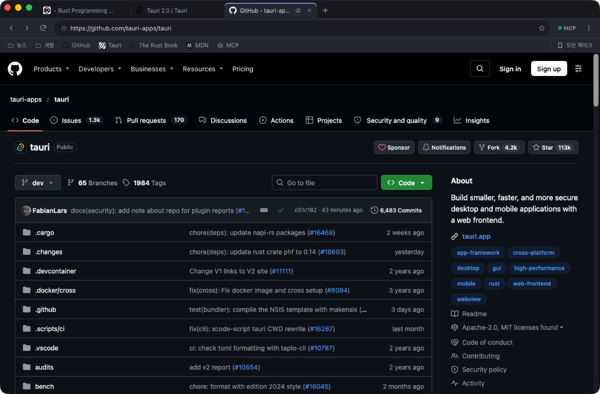
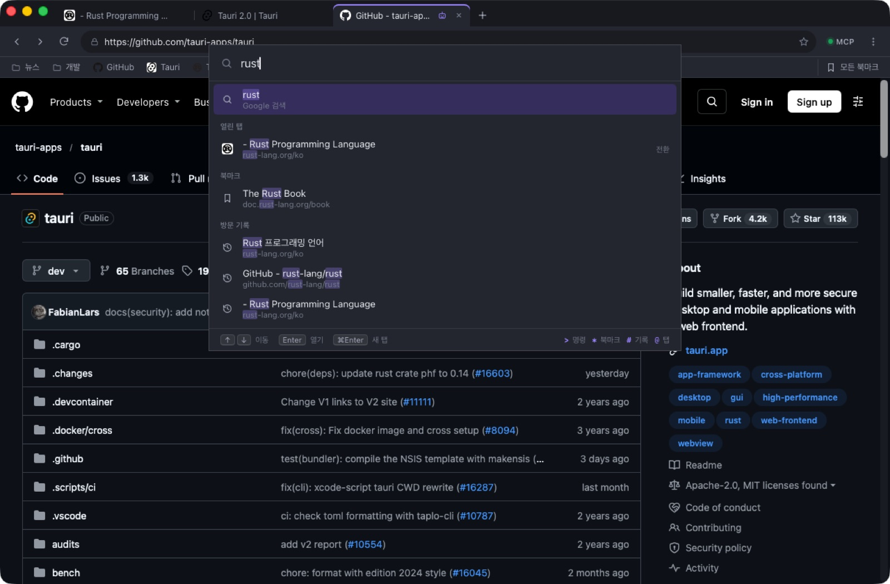
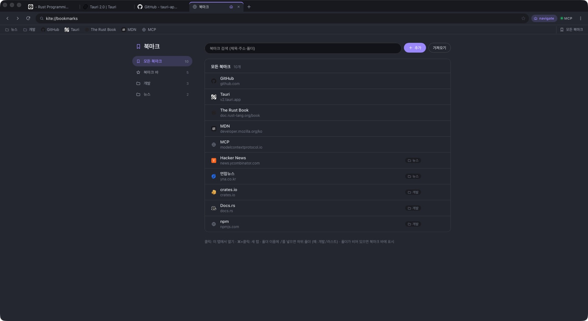
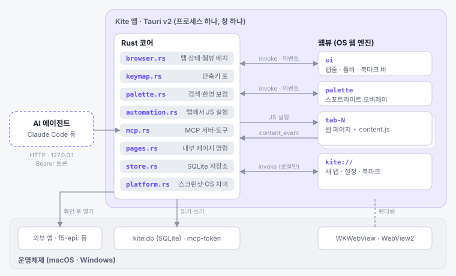

# Kite

[](https://github.com/hiwattc/rust_kite_browser/actions/workflows/ci.yml)
[](https://github.com/hiwattc/rust_kite_browser/releases)

Rust와 Tauri v2로 만든 가벼운 데스크톱 브라우저 (Windows / macOS).
OS에 들어 있는 웹 엔진(Windows WebView2, macOS WKWebView)을 그대로 쓰고, 그 위에 **스포트라이트 검색**과 **AI 에이전트용 MCP 서버**를 얹었습니다.



## 주요 기능

| 기능 | 설명 |
|---|---|
| **탭 브라우징** | 크롬과 비슷한 탭줄·주소창, 탭 끌어서 순서 바꾸기, 닫은 탭 다시 열기, 세션 복원, 확대/축소, 개발자 도구 |
| **스포트라이트** `Ctrl+Shift+P` | 열린 탭·북마크·방문 기록·명령을 한 곳에서 검색. 한/영을 잘못 친 입력(`햣` → `git`)도 찾아 줌 |
| **북마크** | 북마크 바, 폴더 트리 관리자(`kite://bookmarks`), Chrome·Edge·Whale·Brave 북마크 가져오기 |
| **AI 자동화 (MCP)** | Claude Code 같은 에이전트가 Playwright처럼 탭을 조작 (스냅샷·클릭·입력·스크린샷 등 23개 도구). 사용자의 로그인 상태 그대로, 보이는 탭에서 |
| **설정** | `kite://settings` — 검색 엔진, 세션 복원, MCP 서버·토큰, 데이터 삭제, 단축키, 시스템 구성도·아키텍처·오픈소스 |
| **단축키** | 페이지에 포커스가 있어도, 한글 입력 상태에서도 동작 (물리 키 기준) |
| **다운로드 · 외부 앱** | 다운로드는 OS 다운로드 폴더로. `f5-epi:`·`mailto:` 같은 외부 앱 링크는 확인 후 OS에 넘김 (사내 VPN 클라이언트 등) |

## 화면

| 스포트라이트 | 북마크 관리자 |
|---|---|
|  |  |

| 설정 | |
|---|---|
|  | 탭 위의 🤖 표시는 AI 에이전트(MCP)가 쓰고 있는 탭입니다. 툴바에는 지금 실행 중인 도구 이름(`navigate` 등)이 잠깐 보입니다. |

## 설치

[Releases](https://github.com/hiwattc/rust_kite_browser/releases)에서 받으세요.

| OS | 파일 |
|---|---|
| Windows 10/11 (x64) | `Kite_<버전>_x64-setup.exe` — 현재 사용자에게 설치, 관리자 권한 불필요 |
| macOS (Apple Silicon) | `Kite_<버전>_aarch64.dmg` |
| macOS (Intel) | `Kite_<버전>_x64.dmg` |

코드 서명을 하지 않은 빌드입니다. macOS에서 "확인되지 않은 개발자" 경고가 뜨면 앱을 우클릭 → **열기**, 또는 `xattr -cr /Applications/Kite.app`. Windows SmartScreen 경고는 **추가 정보 → 실행**.

## 직접 빌드

필요한 것: Rust(stable), Node.js 22, (Windows) WebView2 런타임 — Windows 10/11에는 기본 포함.

```bash
npm install
npx tauri dev            # 개발 실행 (dev 서버 포트 1440)
npx tauri build          # 설치 파일 (macOS: .app/.dmg, Windows: NSIS .exe)
```

macOS에서 Windows 설치 파일 크로스 빌드:

```bash
rustup target add x86_64-pc-windows-msvc
cargo install cargo-xwin --locked
npx tauri build --runner cargo-xwin --target x86_64-pc-windows-msvc --bundles nsis
```

확인 명령:

```bash
cd src-tauri && cargo clippy --all-targets && cargo test --lib   # Rust
npx tsc --noEmit                                                # 프론트
```

## 시스템 구성



Kite는 **Rust 코어 하나**와 **OS 웹 엔진으로 그리는 웹뷰 여러 개**로 이루어져 있습니다. 웹 페이지는 탭 웹뷰 안에서만 돌고, 앱 기능에는 정해진 통로로만 닿습니다.

| 구성 요소 | 위치 | 역할 |
|---|---|---|
| 탭·창 관리 | `src-tauri/src/browser.rs` | 창 하나에 웹뷰 여러 개(`ui`, `tab-<id>`, `palette`) 배치, 탭 상태 소유, 다운로드·외부 앱 링크 처리 |
| 단축키 | `src-tauri/src/keymap.rs` | UI·팔레트·탭 공통 단축키 표 (`KeyboardEvent.code` 기준) |
| 스포트라이트 | `src-tauri/src/palette.rs`, `hangul.rs` | 탭·북마크·기록·명령 검색, 한/영 오타 보정 |
| 페이지 자동화 | `src-tauri/src/automation.rs`, `inject/content.js` | 탭에서 JS 실행 후 결과 받기, 스냅샷·클릭·입력 헬퍼 |
| MCP 서버 | `src-tauri/src/mcp.rs` | Streamable HTTP(127.0.0.1) + Bearer 토큰, 도구 23개 |
| 내부 페이지 | `src-tauri/src/pages.rs`, `src/settings`, `src/bookmarks`, `src/newtab` | `kite://settings`, `kite://bookmarks`, 새 탭 |
| 저장소 | `src-tauri/src/store.rs` | SQLite 파일 하나(`kite.db`): 북마크·방문 기록·설정·세션 |
| 플랫폼 | `src-tauri/src/platform.rs` | 네이티브 스크린샷(WKWebView takeSnapshot / WebView2 CapturePreview), Windows z-order |
| UI | `src/index`, `src/palette` | 탭줄·툴바·북마크 바, 팔레트 (TypeScript, 프레임워크 없음) |

## 구현 아키텍처

- **창 하나, 웹뷰 여러 개** — 창 안에 `ui`(탭줄·툴바), 탭마다 `tab-N`, 숨겨 둔 `palette` 웹뷰를 겹쳐 놓습니다. 보이는 탭만 배치하고, 복원된 탭은 처음 볼 때 웹뷰를 만듭니다.
- **상태는 Rust가 소유** — 탭 목록·주소·로딩 상태는 Rust가 가지고, 바뀔 때마다 `browser-state` 이벤트로 UI에 보냅니다. UI는 그리기만 하고 버튼은 명령(`invoke`)으로 요청합니다.
- **페이지 자동화** — 모든 탭에 `content.js`(`window.__kite`)를 주입합니다. 앱은 `eval_with_callback`으로 스크립트를 실행하고 결과를 받으며, 비동기 결과는 폴링합니다. 페이지 쪽에서 앱을 부르는 IPC는 쓰지 않습니다.
- **권한 경계** — 웹 페이지(탭)가 부를 수 있는 앱 명령은 `content_event` 하나뿐입니다(`capabilities/content.json`). 내부 페이지 명령은 로컬 페이지에만(`internal.json`), 앱 UI 명령은 UI 웹뷰에만(`chrome.json`) 열려 있습니다. 페이지가 보낸 값은 믿지 않고 주소는 웹뷰에서 다시 읽습니다.
- **MCP 보안** — 루프백 전용, 요청마다 Bearer 토큰, 브라우저 `Origin`이 붙은 요청 거부(열어 둔 웹 페이지가 MCP를 부를 수 없음). 토큰은 소유자만 읽을 수 있는 파일 하나에만 둡니다.
- **외부 앱 링크** — `http(s)`가 아닌 링크(`f5-epi:`, `mailto:` …)는 웹뷰에서 막고, 확인창을 거쳐 OS에 넘깁니다. 페이지가 사용자 몰래 로컬 앱을 실행할 수 없습니다.
- **플랫폼 차이** — OS별 코드는 `platform.rs`에 `cfg`로 모으고, 웹뷰를 만드는 명령은 Windows 교착을 피하려고 `async`로 실행합니다.

## 오픈소스 활용

Kite가 직접 쓰는 오픈소스입니다(간접 의존성 포함 Rust 크레이트 약 540개). 앱 안의 `kite://settings` → **오픈소스**에서도 볼 수 있습니다.

| 분류 | 프로젝트 | 라이선스 | 용도 |
|---|---|---|---|
| 앱 기반 | [Tauri](https://github.com/tauri-apps/tauri) 2.12 (+ [wry](https://github.com/tauri-apps/wry), [tao](https://github.com/tauri-apps/tao)) | Apache-2.0 / MIT | 데스크톱 앱 프레임워크, OS 웹뷰·창 |
| | [tauri-plugin-dialog](https://github.com/tauri-apps/plugins-workspace), [tauri-plugin-opener](https://github.com/tauri-apps/plugins-workspace) | Apache-2.0 / MIT | 확인창, 외부 앱으로 링크 열기 |
| 비동기·네트워크 | [tokio](https://github.com/tokio-rs/tokio), [hyper](https://github.com/hyperium/hyper), hyper-util, http, bytes, tower-service | MIT | 비동기 런타임, MCP용 HTTP 서버 |
| | [url](https://github.com/servo/rust-url), percent-encoding | MIT / Apache-2.0 | 주소 해석 |
| AI 자동화 | [rmcp](https://github.com/modelcontextprotocol/rust-sdk) 3.11 | Apache-2.0 | MCP(Model Context Protocol) 서버 SDK |
| 데이터·보안 | [SQLite](https://sqlite.org) 3.54, [rusqlite](https://github.com/rusqlite/rusqlite) | Public Domain, MIT | 로컬 데이터베이스 (앱에 포함) |
| | [ring](https://github.com/briansmith/ring) | Apache-2.0 / ISC | MCP 토큰 난수 |
| | [serde](https://github.com/serde-rs/serde), serde_json, base64, [dirs](https://github.com/soc/dirs-rs) | MIT / Apache-2.0 | 직렬화, 인코딩, 폴더 찾기 |
| OS·이미지 | [objc2](https://github.com/madsmtm/objc2) (objc2-web-kit, objc2-app-kit) | MIT / Zlib / Apache-2.0 | macOS WKWebView 호출 |
| | [windows-rs](https://github.com/microsoft/windows-rs), [webview2-com](https://github.com/wravery/webview2-rs) | MIT / Apache-2.0 | Windows API, WebView2 호출 |
| | [image](https://github.com/image-rs/image), [arboard](https://github.com/1Password/arboard) | MIT / Apache-2.0 | 스크린샷 변환, 클립보드 |
| 로그·오류 | [tracing](https://github.com/tokio-rs/tracing), [thiserror](https://github.com/dtolnay/thiserror) | MIT / Apache-2.0 | 로그, 오류 타입 |
| 프론트엔드·빌드 | [@tauri-apps/api](https://github.com/tauri-apps/tauri), [TypeScript](https://github.com/microsoft/TypeScript), [Vite](https://github.com/vitejs/vite), [Vitest](https://github.com/vitest-dev/vitest) | Apache-2.0 / MIT | UI 코드, 번들, 테스트 |

웹 엔진 WKWebView(macOS)와 WebView2(Windows)는 운영체제 구성 요소입니다.

## CI/CD

| 워크플로 | 언제 | 하는 일 |
|---|---|---|
| [CI](.github/workflows/ci.yml) | `main` 푸시, PR | macOS·Windows에서 `npm run build`(tsc + vite), `cargo clippy -D warnings`, `cargo test` |
| [Release](.github/workflows/release.yml) | `v*` 태그 푸시 | macOS(Apple Silicon·Intel) `.dmg`, Windows `.exe`를 빌드해 GitHub Release에 올림 ([tauri-action](https://github.com/tauri-apps/tauri-action)) |

새 버전 내기:

```bash
# src-tauri/tauri.conf.json, src-tauri/Cargo.toml, package.json 의 version 을 올린 뒤
git commit -am "release: v0.2.0"
git tag v0.2.0
git push origin main --tags
```

## 스포트라이트

`Ctrl+Shift+P` (macOS는 `⌘⇧P`도 됨). 새 탭(`⌘T`/`Ctrl+T`)을 열면 자동으로 뜹니다.

| 입력 | 결과 |
|---|---|
| 아무 단어 | 열린 탭 · 북마크 · 방문 기록 · 명령 (단어가 모두 들어간 것) + 검색/주소 이동 |
| `>` | 명령만 (새 탭, 북마크, 개발자 도구, 크롬 북마크 가져오기, MCP 연결 명령 복사 …) |
| `*` / `#` / `@` | 북마크만 / 방문 기록만 / 열린 탭만 |
| 한/영 잘못 친 입력 | `햣` → `git`, `qntks` → `부산` 으로도 찾아 줌 |

`↑↓` 이동, `Enter` 열기, `⌘Enter`/`Ctrl+Enter` 새 탭에서 열기, `Esc` 닫기.

## 설정 · 북마크

| 페이지 | 여는 법 | 내용 |
|---|---|---|
| `kite://settings` | `⌘,` / `Ctrl+,`, 주소창에 `chrome://settings`, 스포트라이트 `> 설정` | 검색 엔진, 시작할 때 탭 복원, 북마크 바, MCP(켜기·포트·연결 명령·토큰 재발급), 방문 기록·쿠키 삭제, 단축키 목록 |
| `kite://bookmarks` | `⌘⌥B` / `Ctrl+Shift+O`, 북마크 바의 `모든 북마크` | 폴더 트리, 검색, 추가·편집·삭제, 다른 브라우저에서 가져오기 |

- **북마크 바**: `⌘⇧B` / `Ctrl+Shift+B`로 켜고 끔. 폴더가 비어 있는 북마크(크롬의 북마크바에서 가져온 것 포함)가 링크로, 최상위 폴더가 📁 버튼으로 보이고, 폴더를 누르면 스포트라이트에 그 폴더의 북마크가 뜹니다(`*/폴더명`). 넘치는 항목은 `»`.
- 북마크 바 링크: 클릭은 현재 탭, `⌘`/`Ctrl`+클릭·휠 클릭은 새 탭.
- 내부 페이지는 웹 페이지가 열거나 호출할 수 없고, AI 에이전트도 스크립트를 실행할 수 없습니다.

## 단축키

| 동작 | macOS | Windows |
|---|---|---|
| 스포트라이트 | `⌃⇧P`, `⌘⇧P` | `Ctrl+Shift+P` |
| 새 탭 / 탭 닫기 / 닫은 탭 다시 열기 | `⌘T` / `⌘W` / `⌘⇧T` | `Ctrl+T` / `Ctrl+W` / `Ctrl+Shift+T` |
| 주소창 | `⌘L` | `Ctrl+L`, `Alt+D`, `F6` |
| 새로고침 / 강력 새로고침 | `⌘R` / `⌘⇧R` | `F5`, `Ctrl+R` / `Ctrl+F5` |
| 뒤로 / 앞으로 | `⌘[` / `⌘]` | `Alt+←` / `Alt+→` |
| 다음/이전 탭 | `⌃Tab`, `⌘⌥→/←` | `Ctrl+Tab`, `Ctrl+PgDn/PgUp` |
| N번째 탭 / 마지막 탭 | `⌘1`…`⌘8` / `⌘9` | `Ctrl+1`…`8` / `Ctrl+9` |
| 북마크 추가/삭제 | `⌘D` | `Ctrl+D` |
| 북마크 바 / 북마크 관리자 / 설정 | `⌘⇧B` / `⌘⌥B` / `⌘,` | `Ctrl+Shift+B` / `Ctrl+Shift+O` / `Ctrl+,` |
| 탭 검색 / 기록 검색 | `⌘⇧A` / `⌘Y` | `Ctrl+Shift+A` / `Ctrl+H` |
| 확대 / 축소 / 원래대로 | `⌘=` / `⌘-` / `⌘0` | `Ctrl+=` / `Ctrl+-` / `Ctrl+0` |
| 개발자 도구 | `F12`, `⌘⌥I` | `F12`, `Ctrl+Shift+I` |

단축키는 페이지 안에 포커스가 있어도, 한글 입력 상태에서도 동작합니다(물리 키 기준).

## Claude Code 연결 (MCP)

Kite를 켜면 MCP 서버가 `http://127.0.0.1:17321/mcp`에서 자동으로 시작됩니다(툴바의 `● MCP`가 초록색).

1. 툴바의 **MCP** 버튼을 누르거나, 스포트라이트에서 `> Claude Code 연결 명령 복사`
2. 터미널에 붙여 넣기:
   ```bash
   claude mcp add --transport http --scope user kite http://127.0.0.1:17321/mcp --header "Authorization: Bearer <토큰>"
   ```
3. Claude Code에서 "kite 브라우저로 ○○ 사이트 열고 △△ 해 줘"

에이전트가 쓰는 탭은 탭 위에 보라색 줄과 🤖 표시가, 툴바에는 지금 실행 중인 도구 이름이 잠깐 보입니다.
클릭한 요소는 페이지에 보라색 테두리로 잠깐 표시됩니다.

### 도구

| 도구 | 설명 |
|---|---|
| `browser_tabs` | 탭 목록 / 새 탭 / 선택 / 닫기 |
| `browser_navigate`, `_back`, `_forward`, `browser_reload` | 이동 (로딩·리다이렉트 끝까지 대기) |
| `browser_snapshot` | 접근성 트리 형태의 페이지 구조, 조작할 요소에 `[ref=eN]` |
| `browser_click`, `browser_type`, `browser_fill_form`, `browser_select_option`, `browser_press_key`, `browser_hover`, `browser_scroll` | 조작 (ref·CSS selector·보이는 글자로 대상 지정, `snapshot=true`면 결과에 스냅샷 첨부) |
| `browser_wait_for` | 글자/요소가 나타나거나 사라질 때까지 대기 |
| `browser_evaluate` | JavaScript 실행 (식·함수·`return` 문장, `await` 가능) |
| `browser_take_screenshot` | 보이는 영역 또는 요소 스크린샷 (기본 JPEG 1280px) |
| `browser_get_text`, `browser_get_html` | 본문 글자 / HTML |
| `browser_console_messages`, `browser_network_requests` | 콘솔 로그, fetch/XHR 기록 |
| `browser_handle_dialog` | alert/confirm/prompt 자동 응답 설정 |
| `bookmarks`, `history_search` | 북마크 검색·추가·삭제, 방문 기록 검색 |

### 보안

- 127.0.0.1에서만 받고, 모든 요청에 Bearer 토큰을 확인하며, 브라우저 `Origin`이 붙은 요청은 거부합니다(열어 둔 웹 페이지가 MCP를 부를 수 없음).
- 토큰: macOS `~/Library/Application Support/com.kite.browser/mcp-token`, Windows `%APPDATA%\com.kite.browser\mcp-token` (소유자만 읽기). 지우면 다음 실행 때 새로 만들어집니다.
- 웹 페이지가 앱에 보낼 수 있는 것은 단축키 알림과 주소 변경 알림 뿐입니다.
- 끄기·포트 변경·토큰 재발급: `kite://settings` → AI 자동화.

## 알려진 한계

- 엔진은 OS 웹뷰입니다: Windows는 Chromium 기반(WebView2), macOS는 WebKit(Safari와 같은 엔진).
- 자동화 입력은 페이지 안에서 만든 합성 이벤트(`isTrusted=false`)라 일부 사이트(봇 차단, 일부 에디터)에서는 동작이 다를 수 있습니다.
- 스크린샷은 보이는 영역만(전체 페이지 X), 다른 출처의 iframe 내부는 스냅샷·조작 불가.
- macOS에서 페이지의 alert/confirm은 아직 창으로 뜨지 않습니다(wry 한계, `browser_handle_dialog`로는 처리됨). → `docs/PLAN.md`
- 확장 프로그램, 여러 창, 프로필은 아직 없습니다.

## 데이터 위치

| 내용 | 위치 |
|---|---|
| 북마크 · 방문 기록 · 설정 · 세션 | `kite.db` (SQLite) — macOS `~/Library/Application Support/com.kite.browser/`, Windows `%APPDATA%\com.kite.browser\` |
| 쿠키·캐시 | OS 웹뷰 기본 저장소 |
| 다운로드 | OS 다운로드 폴더 (이름이 겹치면 ` (1)` 붙임) |
