# Kite

[](https://github.com/hiwattc/rust_kite_browser/actions/workflows/ci.yml)
[](https://github.com/hiwattc/rust_kite_browser/releases)

Rust와 Tauri v2로 만든 가벼운 데스크톱 브라우저 (Windows / macOS).
OS에 들어 있는 웹 엔진(Windows WebView2, macOS WKWebView)을 그대로 쓰고, 그 위에 **스포트라이트 검색**과 **AI 에이전트용 MCP 서버**를 얹었습니다.

<p align="center">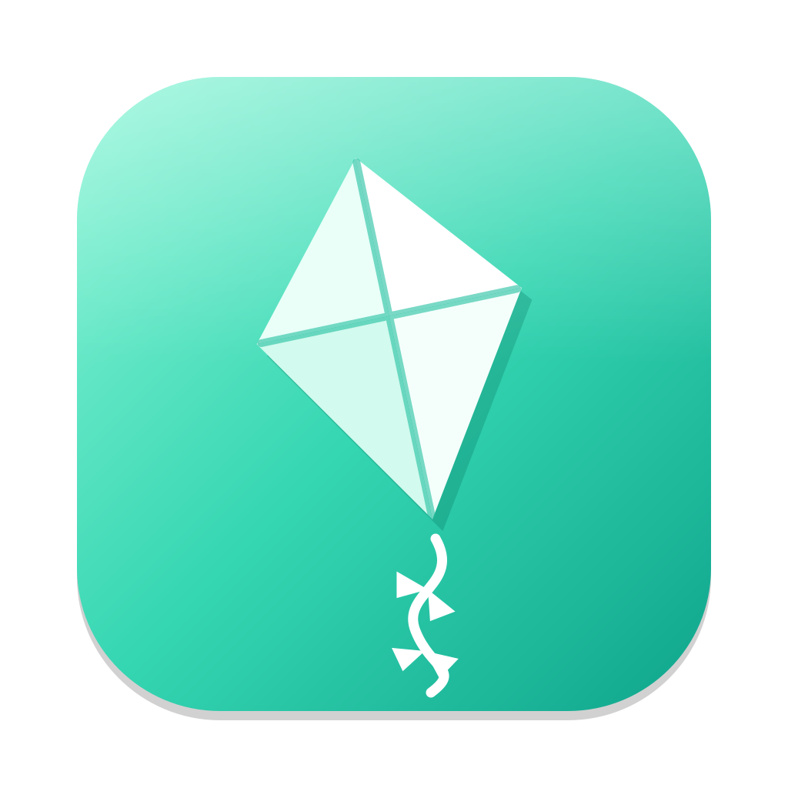</p>


## 주요 기능

| 기능 | 설명 |
|---|---|
| **탭 브라우징** | 크롬과 비슷한 탭줄·주소창(Windows는 제목 표시줄 없이 탭이 창 맨 위, 탭줄 오른쪽에 최소화·최대화·닫기, 빈 곳을 끌어 이동·두 번 눌러 최대화), **세로 탭 목록**(툴바 맨 앞 버튼: 왼쪽 패널에 이 창의 탭을 세로로, 아래에서 열린 탭↔북마크 전환, 검색 필터·↑↓ Enter·끌어서 순서 변경·폭 조절)(자동완성: `you` → `youtube.com`, 방문 기록·북마크·인기 사이트 추천 목록), 탭 끌어서 순서 바꾸기·새 창으로 분리(창 밖에 놓기)·다른 창에 합치기(탭줄에 놓기), 여러 창, 닫은 탭 다시 열기, 세션 복원, 확대/축소(Ctrl+휠 포함), 개발자 도구 |
| **스포트라이트** `Ctrl+Shift+P` | 열린 탭·북마크·방문 기록·명령을 한 곳에서 검색. 한/영을 잘못 친 입력(`햣` → `git`)도 찾아 줌 |
| **홈 (개인 포털)** | `kite://home` (툴바 집 버튼, 팔레트 `> 홈`). iGoogle 같은 시작 화면: 워크스페이스 탭(추가·이름 바꾸기·삭제), 시계·인사말·검색창(`/`), 워크스페이스마다 섹션을 자유롭게 배치(12칸 격자, 편집 모드에서 섹션 추가·이름 바꾸기·삭제, 제목을 끌어 옮기고 모서리를 끌어 가로/세로 크기 조절). 섹션 종류: 스마트폰처럼 둥근 앱 아이콘(기본은 사이트가 주는 가장 큰 아이콘, 글자+색 또는 이미지로 바꾸기, 이름·주소 수정, 끌어서 순서 변경·다른 섹션으로 이동), 할 일 목록(추가·체크·두 번 눌러 고치기·필터·완료 지우기). 워크스페이스를 JSON 파일로 내보내기/불러오기. 처음엔 자주 간 사이트로 채움. 데이터는 Kite DB에 저장 |
| **접속 불가 화면** | 주소에 접속하지 못하면(macOS) 원인을 직접 진단해(인터넷 끊김·주소 없음·연결 거부·응답 없음·보안 연결 실패·인증서) 안내와 "다시 시도"를 보여 줌. 배경은 매번 무작위로 둘 중 하나: three.js로 그린 무인도에서 파라솔 아래 책 읽는 장면(테마에 따라 낮/노을), 또는 줄이 끊어져 날아가는 연을 흑백 선화로 그린 단순한 화면(테마에 따라 흰 바탕/검은 바탕). 주소창엔 실패한 주소가 그대로 남고 ⌘R은 그 주소로 다시 시도, 인터넷이 돌아오면 자동 재시도. 인증서 오류(만료·자체 서명·다른 주소용)면 이유를 한국어로 보여 주고, 크롬처럼 **고급 → ‘…(으)로 이동 (안전하지 않음)’**으로 그 사이트만 이번 실행 동안 계속 접속(주소창엔 빨간 ⚠). Windows는 WebView2 기본 오류 화면 |
| **사이트 정보** | 주소창 앞 자물쇠(https)·경고(http) 아이콘을 누르면 Chrome처럼 연결 보안 상태와 인증서(발급 대상·발급자·유효 기간·남은 일수·공개 키·대체 이름·체인·SHA-256 지문)를 보여 줌. macOS는 페이지가 실제로 받은 인증서(WKWebView serverTrust), Windows는 Kite가 따로 연결해 받은 인증서 |
| **전역 스포트라이트** | 다른 앱을 쓰는 중에도 `⌥Space`(Windows `F9`)를 누르면 Kite 검색창이 화면 위에 떠서(Spotlight·Everything처럼) 탭·북마크·기록·명령·주소를 바로 찾고 열 수 있음. Esc·바깥 클릭으로 닫히면 쓰던 앱으로 돌아감. 설정 → 일반에서 끄거나 단축키 변경(누른 조합을 그대로 기록, F1~F24는 하나만으로도 가능 — 예: Windows `F9`) |
| **영상회의** | `kite://meet`(스포트라이트 `> 영상회의`): 여러 명(메시, 4~6명 권장) 화상회의, 화면 공유, 채팅. **새 회의 만들기** → 이 Kite가 회의 서버가 되어 초대 코드를 줌(공유기 UPnP로 포트 자동 개방) → 참가자는 코드만 붙여 넣으면 참가 요청 → 호스트가 **수락**하면 입장. 서버는 참가 요청·연결 정보만 중계(초대 코드의 키로 AES-256-GCM 암호화), 영상·음성은 참가자끼리 직접 암호화 전송 |
| **테마** | 색 테마 11개(기본 + 오션·포레스트·선셋·벚꽃·샌드·미드나잇·노르딕·그레이프·모카·그래파이트), 설정 → 모양에서 미리보기로 고르면 모든 창에 바로 적용. 기본은 운영체제 라이트/다크를 따름 |
| **북마크** | 북마크 바(툴바·탭줄·북마크 바 빈 곳 우클릭 메뉴에서 보이기/감추기, `⇧⌘B`), 폴더 트리 관리자(`kite://bookmarks`), Chrome·Edge·Whale·Brave 북마크 가져오기 |
| **확장 프로그램** | 크롬 웹 스토어 주소(또는 ID)로 설치, 압축을 푼 폴더에서 설치, 주소창 옆 툴바 아이콘·팝업(크롬처럼 아이콘 아래). 샘플: `samples/kite-sample-extension`. `kite://extensions`에서 관리 (macOS 15.4+ WebKit 확장 엔진, Windows WebView2 확장) |
| **비밀번호 관리자** | 로그인하면 저장할지 묻고, 같은 사이트에 다시 오면 아이디·비밀번호 자동 입력. 비밀번호는 암호화해 저장하고 키는 OS 키체인(Windows 자격 증명 관리자)에. `kite://passwords`에서 보기·복사·삭제 |
| **AI 자동화 (MCP)** | Claude Code 같은 에이전트가 Playwright처럼 탭을 조작 (스냅샷·클릭·입력·스크린샷 등 23개 도구). 사용자의 로그인 상태 그대로, 보이는 탭에서 |
| **설정** | `kite://settings` — 검색 엔진, 세션 복원, MCP 서버·토큰, 데이터 삭제, 단축키, 시스템 구성도·아키텍처·오픈소스 |
| **단축키** | 페이지에 포커스가 있어도, 한글 입력 상태에서도 동작 (물리 키 기준) |
| **다운로드** | 크롬처럼 툴바에 다운로드 버튼이 나타나 **원형 진행 링**으로 진행률을 보여 줌(크기를 모르면 회전, 끝나면 반짝). `kite://downloads`(버튼 클릭, `⌥⌘L` / `Ctrl+J`, 스포트라이트 `> 다운로드`): 받는 중(진행 막대·속도·남은 시간·**취소**), 날짜별 기록, 열기·**Finder/폴더에서 보기**·다시 받기·목록에서 삭제, 검색, **다운로드 폴더 열기**. 설정 → 일반에서 저장 위치 변경. 같은 이름은 `(1)`을 붙여 덮어쓰지 않음 |
| **외부 앱** | 다운로드는 OS 다운로드 폴더로. `f5-epi:`·`mailto:` 같은 외부 앱 링크는 확인 후 OS에 넘김 (사내 VPN 클라이언트 등) |

## 화면

| 홈 (개인 포털) | 홈 편집 모드 (섹션 이동·크기 조절) |
|---|---|
| 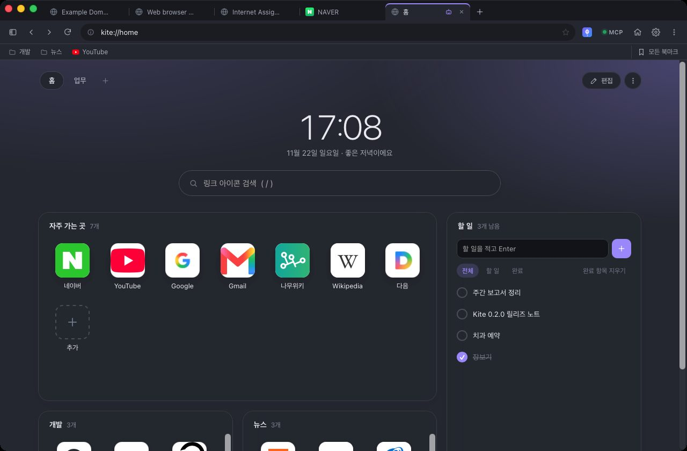 | 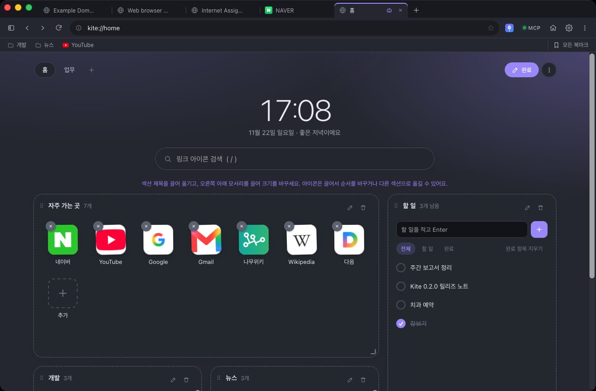 |

| 접속 불가 — 무인도 (three.js) | 접속 불가 — 끊어진 연 (흑백) |
|---|---|
| 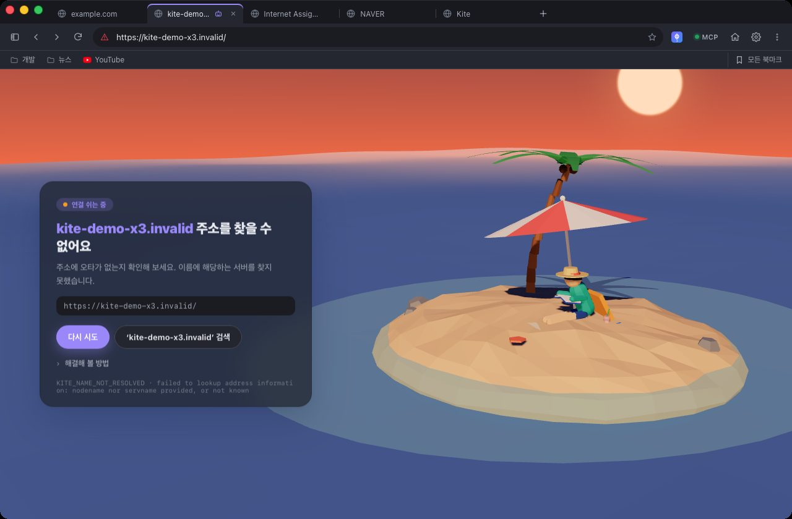 | 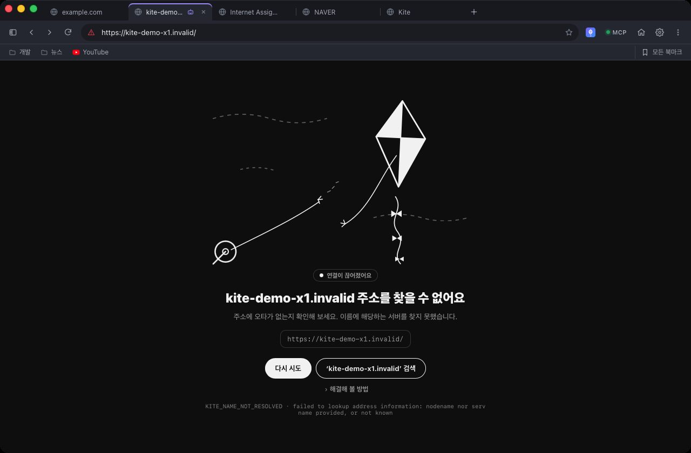 |

| 세로 탭 목록 | 세로 패널 — 북마크 |
|---|---|
|  | 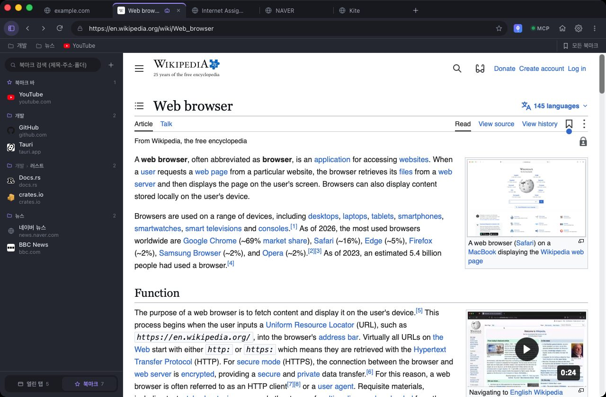 |

| 사이트 정보 (인증서) | 주소창 자동완성 |
|---|---|
| 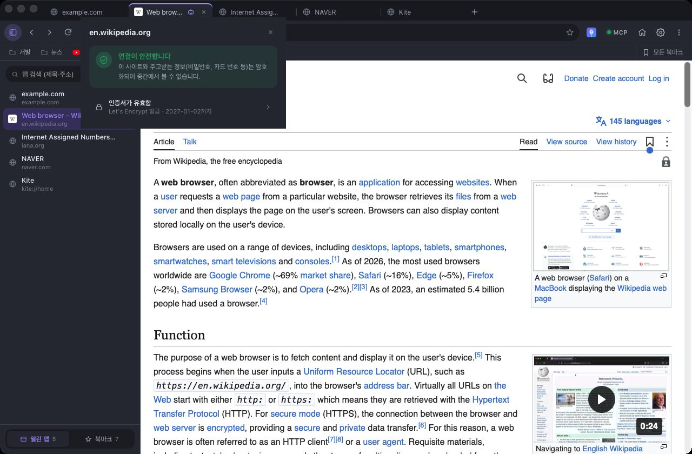 | 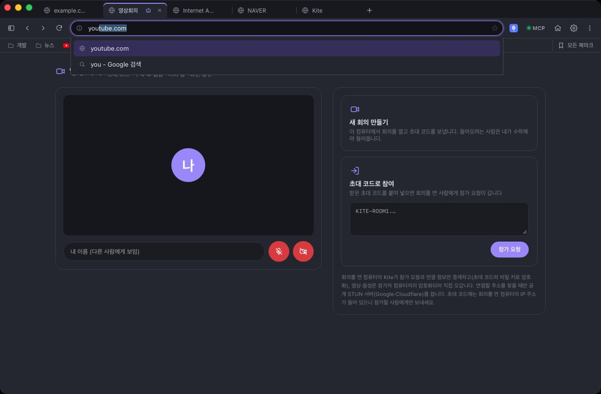 |

| 다운로드 관리자 (`kite://downloads`) | |
|---|---|
| 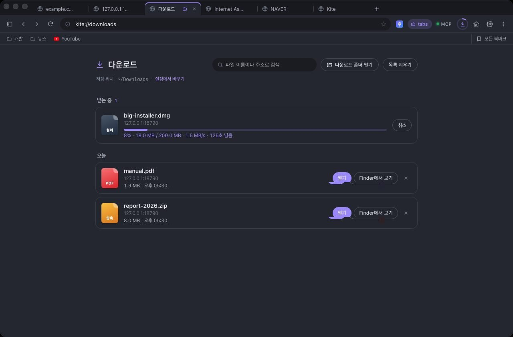 | 툴바의 다운로드 버튼에 원형 링으로 진행률이 표시되고(크기를 모르면 회전), 누르면 이 화면이 열립니다. 받는 중인 파일은 속도·남은 시간과 **취소**, 받은 파일은 **열기 / Finder(폴더)에서 보기**. |

| 영상회의 | 테마 11개 |
|---|---|
| 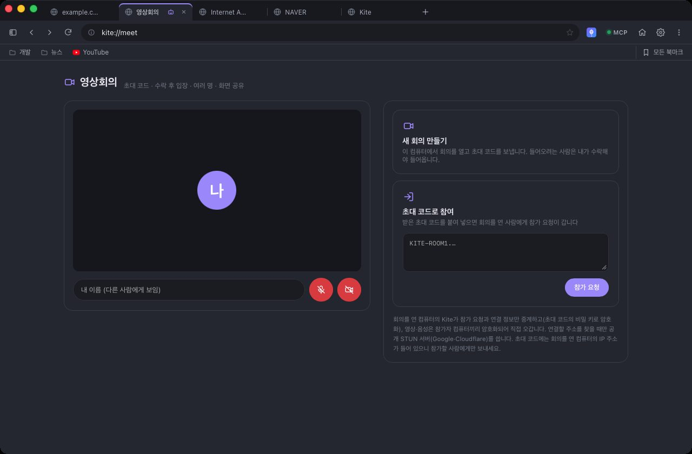 | 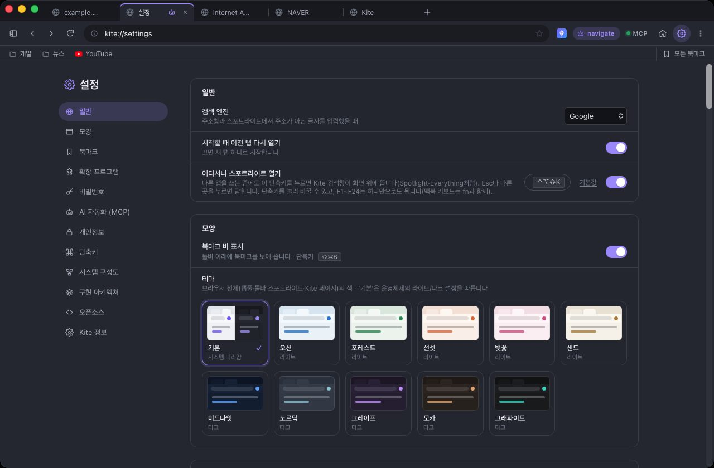 |

| 스포트라이트 | 북마크 관리자 |
|---|---|
|  |  |

| 설정 | |
|---|---|
| 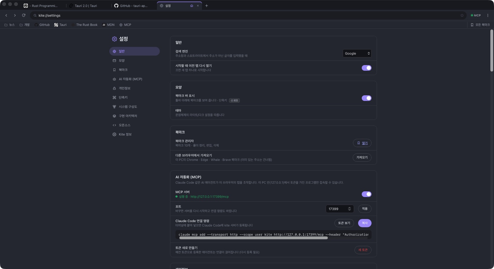 | 탭 위의 🤖 표시는 AI 에이전트(MCP)가 쓰고 있는 탭입니다. 툴바에는 지금 실행 중인 도구 이름(`navigate` 등)이 잠깐 보입니다. |

## 구현된 기능과 구현 방식

| 기능 | 어떻게 구현했나 | 주요 코드 |
|---|---|---|
| 탭·창·웹뷰 | 창마다 웹뷰 여러 개(`ui`·`tab-N`·`palette`·`omni`·`side`·`cover`)를 겹쳐 배치. 탭 상태는 Rust가 소유하고 `browser-state` 이벤트로 UI에 보냄. 탭 끌어서 분리·합치기 | `browser.rs`, `src/index` |
| 스포트라이트 | 탭·북마크·기록·명령을 Rust에서 점수 매겨 검색, 한/영 자판 변환으로 잘못 친 입력 보정 | `palette.rs`, `hangul.rs`, `src/palette` |
| 전역 스포트라이트 | `tauri-plugin-global-shortcut`으로 OS 전역 단축키 등록 → 떠 있는 `launcher` 창(팔레트 페이지 재사용). 단축키는 설정에서 녹화(F키 단독 가능) | `launcher.rs` |
| 주소창 자동완성 | 입력마다 방문 기록(빈도·최근)·북마크·인기 사이트에서 찾아 인라인 완성 + 별도 `omni` 웹뷰에 추천 목록 | `omnibox.rs`, `src/omni` |
| 세로 탭 패널 | 왼쪽 `side` 웹뷰, 열리면 `layout`이 탭 웹뷰를 오른쪽으로 밀어 배치. 열린 탭/북마크 전환·검색·끌어서 순서 변경·폭 조절 | `browser.rs`, `src/side` |
| 홈 (개인 포털) | 페이지가 12칸 격자 섹션(앱 아이콘·할 일)을 그리고 편집(드래그 이동·모서리 크기 조절·아이콘 섹션 간 이동). 데이터 JSON은 store kv에, 사이트 아이콘은 Rust가 HTML `<link rel=icon>`을 읽어 가장 큰 것(apple-touch-icon 우선)을 data URL로. 내보내기/불러오기는 파일 대화상자 | `portal.rs`, `src/home` |
| 접속 불가 화면 | wry가 실패를 알려 주지 않아, Kite가 시작한 이동마다 WKWebView `isLoading`을 관찰해 commit 없이 멈추면 실패로 판단 → 직접 DNS/TCP/TLS로 원인 진단 → three.js 무인도 또는 SVG 흑백 연 화면(무작위). 주소창엔 원래 주소 유지 | `neterror.rs`, `src/neterror` |
| 인증서 예외 (계속 진행) | wry 내비게이션 델리게이트 클래스에 objc 런타임으로 `didReceiveAuthenticationChallenge`를 추가하고 델리게이트를 다시 붙임. 사용자가 허용한 호스트만 서버 신뢰를 받아들이고 나머지는 기본 처리(이번 실행 동안만) | `platform.rs`, `neterror.rs` |
| 사이트 정보 | macOS는 페이지가 받은 인증서(`serverTrust`), Windows는 rustls로 따로 연결해 받은 체인을 x509-parser로 풀어 말풍선 창에 표시 | `siteinfo.rs`, `src/siteinfo` |
| 영상회의 | 호스트 Kite가 TCP 서버를 열고 UPnP(igd-next)로 공유기 포트 개방, 초대 코드 키로 AES-256-GCM 암호화해 참가 요청·시그널링 중계. 영상·음성은 WebRTC 메시로 참가자끼리 직접 | `meet.rs`, `src/meet` |
| 오래된 탭 되살리기 | macOS가 숨은 탭 프로세스를 끝내면 바로 다시 불러오지 않고 표시만 → 다시 볼 때 `cover` 웹뷰에 마지막 화면을 덮고 reload 후 스크롤 복원 | `lib.rs`, `browser.rs`, `src/cover` |
| 로그인 유지 | 세션 쿠키를 주기적으로 `session-cookies.json`(0600)에 저장했다가 다음 실행 때 첫 탭 전에 복원 | `session_cookies.rs` |
| 팝업 창 | 크기를 준 `window.open`·빈 팝업은 엔진이 만든 창을 그대로 별도 창으로(`opener` 유지), 나머지는 새 탭 | `browser.rs` |
| 테마 | CSS 변수 토큰 11세트, 설정에서 고르면 모든 웹뷰에 이벤트로 적용 | `src/styles/base.css`, `src/shared/theme.ts` |
| 북마크 | SQLite에 북마크·폴더, 트리 관리자(검색·접기·드래그 이동·빈 폴더), Chrome 계열 북마크 가져오기 | `store.rs`, `pages.rs`, `src/bookmarks` |
| 확장 프로그램 | CRX 받기·풀기 → macOS `WKWebExtensionController`, Windows WebView2 `AddBrowserExtension`. 툴바 아이콘·팝업 | `extensions.rs`, `platform.rs` |
| 비밀번호 관리자 | 폼 제출 감지 → 출처 재확인 후 저장 제안, AES-256-GCM 암호화, 키는 OS 키체인 | `passwords.rs` |
| 다운로드 | Tauri는 시작·끝만 알려 줘서, macOS에선 wry 다운로드 델리게이트의 `decideDestinationUsingResponse`를 objc 런타임으로 감싸 `WKDownload`(진행률 `NSProgress`, 취소)와 응답의 전체 크기를 받음. Windows는 디스크의 파일 크기로 진행률(전체 크기 모름). 기록은 store에 최근 300개, 상태는 `downloads` 이벤트로 툴바(원형 링)·`kite://downloads`에 | `downloads.rs`, `platform.rs`, `src/downloads` |
| AI 자동화 (MCP) | Streamable HTTP(127.0.0.1)+Bearer 토큰+Origin 거부, 도구 23개. 탭에 주입한 `content.js` 헬퍼를 `eval_with_callback`으로 실행 | `mcp.rs`, `automation.rs`, `inject/content.js` |

## 설치

[Releases](https://github.com/hiwattc/rust_kite_browser/releases)에서 받으세요.

| OS | 파일 |
|---|---|
| Windows 10/11 (x64) | `Kite_<버전>_x64-setup.exe` — 현재 사용자에게 설치, 관리자 권한 불필요 |
| macOS (Apple Silicon) | `Kite_<버전>_aarch64.dmg` |
| macOS (Intel) | `Kite_<버전>_x64.dmg` |

코드 서명을 하지 않은 빌드입니다. macOS에서 "확인되지 않은 개발자" 경고가 뜨면 앱을 우클릭 → **열기**, 또는 `xattr -cr /Applications/Kite.app`. Windows SmartScreen 경고는 **추가 정보 → 실행**.

## 직접 빌드

필요한 것: Rust(stable), Node.js 22, (Windows) WebView2 런타임 — Windows 10/11에는 기본 포함.

```bash
npm install
npx tauri dev            # 개발 실행 (dev 서버 포트 1440)
npx tauri build          # 설치 파일 (macOS: .app/.dmg, Windows: NSIS .exe)
```

macOS에서 Windows 설치 파일 크로스 빌드:

```bash
rustup target add x86_64-pc-windows-msvc
cargo install cargo-xwin --locked
npx tauri build --runner cargo-xwin --target x86_64-pc-windows-msvc --bundles nsis
```

확인 명령:

```bash
cd src-tauri && cargo clippy --all-targets && cargo test --lib   # Rust
npx tsc --noEmit                                                # 프론트
```

## 시스템 구성


Kite는 **Rust 코어 하나**와 **OS 웹 엔진으로 그리는 웹뷰 여러 개**로 이루어져 있습니다. 구성도는 `src/settings/diagram.ts`에서 만들며(앱의 설정 → 시스템 구성도와 같은 그림), `node --experimental-strip-types scripts/diagram.mjs`로 이 SVG를 다시 씁니다. 웹 페이지는 탭 웹뷰 안에서만 돌고, 앱 기능에는 정해진 통로로만 닿습니다.

| 구성 요소 | 위치 | 역할 |
|---|---|---|
| 탭·창 관리 | `src-tauri/src/browser.rs` | 창마다 웹뷰 여러 개(`ui`, `tab-<id>`, `palette`, `omni`, `side`, `cover`) 배치, 탭 상태 소유, 팝업 창, 다운로드·외부 앱 링크 처리 |
| 단축키 | `src-tauri/src/keymap.rs` | UI·팔레트·탭 공통 단축키 표 (`KeyboardEvent.code` 기준) |
| 스포트라이트 | `src-tauri/src/palette.rs`, `hangul.rs` | 탭·북마크·기록·명령 검색, 한/영 오타 보정 |
| 페이지 자동화 | `src-tauri/src/automation.rs`, `inject/content.js` | 탭에서 JS 실행 후 결과 받기, 스냅샷·클릭·입력 헬퍼 |
| MCP 서버 | `src-tauri/src/mcp.rs` | Streamable HTTP(127.0.0.1) + Bearer 토큰, 도구 23개 |
| 내부 페이지 | `src-tauri/src/pages.rs`, `src/settings`, `src/bookmarks`, `src/newtab` | `kite://settings`, `kite://bookmarks`, 새 탭 (홈·영상회의·접속 불가는 아래) |
| 비밀번호 | `src-tauri/src/passwords.rs` | 저장 제안·자동 입력, AES-256-GCM 암호화, 키는 OS 키체인 |
| 저장소 | `src-tauri/src/store.rs` | SQLite 파일 하나(`kite.db`): 북마크·방문 기록·설정·세션 |
| 확장 프로그램 | `src-tauri/src/extensions.rs` | 웹 스토어 CRX 받기·풀기, 폴더에서 설치, manifest 읽기 |
| 주소창 자동완성 | `src-tauri/src/omnibox.rs`, `src/omni` | 방문 기록·북마크·인기 사이트 추천, 인라인 완성, `omni` 오버레이 웹뷰 |
| 전역 스포트라이트 | `src-tauri/src/launcher.rs` | 전역 단축키로 뜨는 떠 있는 검색 창 |
| 홈 (개인 포털) | `src-tauri/src/portal.rs`, `src/home` | 워크스페이스·섹션 데이터 저장, 사이트 아이콘 받기, 내보내기/불러오기 |
| 접속 불가 화면 | `src-tauri/src/neterror.rs`, `src/neterror` | 실패 감지·원인 진단, 인증서 예외(계속 진행) |
| 사이트 정보 | `src-tauri/src/siteinfo.rs`, `src/siteinfo` | 인증서 체인 읽기·해석, 말풍선 창 |
| 영상회의 | `src-tauri/src/meet.rs`, `src/meet` | 회의 서버(TCP+UPnP), 암호화 중계, WebRTC 메시 |
| 로그인 유지 | `src-tauri/src/session_cookies.rs` | 세션 쿠키 저장·복원 |
| 다운로드 | `src-tauri/src/downloads.rs`, `src/downloads` | 저장 위치·진행률·취소·기록, `kite://downloads` |
| 플랫폼 | `src-tauri/src/platform.rs` | 네이티브 스크린샷(WKWebView takeSnapshot / WebView2 CapturePreview), 확장 엔진(WKWebExtensionController / WebView2), Windows z-order |
| UI | `src/index`, `src/palette` | 탭줄·툴바·북마크 바, 팔레트 (TypeScript, 프레임워크 없음) |

## 구현 아키텍처

- **창 하나, 웹뷰 여러 개** — 창 안에 `ui`(탭줄·툴바), 탭마다 `tab-N`, 숨겨 둔 `palette` 웹뷰를 겹쳐 놓습니다. 보이는 탭만 배치하고, 복원된 탭은 처음 볼 때 웹뷰를 만듭니다.
- **상태는 Rust가 소유** — 탭 목록·주소·로딩 상태는 Rust가 가지고, 바뀔 때마다 `browser-state` 이벤트로 UI에 보냅니다. UI는 그리기만 하고 버튼은 명령(`invoke`)으로 요청합니다.
- **페이지 자동화** — 모든 탭에 `content.js`(`window.__kite`)를 주입합니다. 앱은 `eval_with_callback`으로 스크립트를 실행하고 결과를 받으며, 비동기 결과는 폴링합니다. 페이지 쪽에서 앱을 부르는 IPC는 쓰지 않습니다.
- **권한 경계** — 웹 페이지(탭)가 부를 수 있는 앱 명령은 `content_event` 하나뿐입니다(`capabilities/content.json`). 내부 페이지 명령은 로컬 페이지에만(`internal.json`), 앱 UI 명령은 UI 웹뷰에만(`chrome.json`) 열려 있습니다. 페이지가 보낸 값은 믿지 않고 주소는 웹뷰에서 다시 읽습니다.
- **MCP 보안** — 루프백 전용, 요청마다 Bearer 토큰, 브라우저 `Origin`이 붙은 요청 거부(열어 둔 웹 페이지가 MCP를 부를 수 없음). 토큰은 소유자만 읽을 수 있는 파일 하나에만 둡니다.
- **확장 프로그램** — 웹 스토어의 CRX를 받아 `extensions/<ID>/`에 풀고 OS 엔진에 올립니다. macOS는 탭마다 `WKWebViewConfiguration`에 `WKWebExtensionController`를 붙이고(확장 페이지는 그 확장 전용 설정의 웹뷰로 열기), Windows는 WebView2 `AddBrowserExtension`. WebKit이 확장을 올린 뒤 만든 탭에는 차단 규칙(declarativeNetRequest)을 주지 않아서, 새 탭이 생기면 차단 규칙이 있는 확장을 다시 올립니다(컴파일 결과는 캐시).
- **비밀번호** — 폼 제출을 `content.js`가 알리면 Rust가 사이트 주소를 웹뷰에서 다시 읽어, 페이지가 말한 출처와 같을 때만 저장을 묻습니다(Kite 창의 시트). 비밀번호는 AES-256-GCM으로 암호화해 `kite.db`에 두고 키는 OS 키체인에만 있습니다. 자동 입력은 출처가 정확히 같을 때만, Rust가 탭에서 스크립트를 실행해 하고 페이지 안에서 출처를 한 번 더 확인합니다. 로그에는 비밀번호를 남기지 않고, AI 에이전트용 스냅샷에서도 비밀번호 칸은 `••••`로 가립니다.
- **오래된 탭 되살리기(macOS)** — macOS는 메모리가 부족하면 안 보이는 탭의 페이지 프로세스를 끝냅니다(Safari도 같음). Tauri 기본 동작은 그때 바로 다시 불러와 뒤에서 탭들이 새로고침되는데, Kite는 그 탭을 표시만 해 두고 **다시 열 때** 불러옵니다. 보던 탭의 화면을 10초마다·로드 직후 메모리에 찍어 두었다가, 다시 불러오는 동안 그 화면을 덮어 보여 주고(‘다시 불러오는 중’) 스크롤 위치를 되돌린 뒤 걷어 냅니다.
- **로그인 유지(세션 쿠키)** — 만료일 없는 세션 쿠키에만 로그인을 두는 사이트(네이버 등)는 브라우저를 닫으면 로그아웃됩니다. Chrome의 "중단한 위치에서 계속하기"처럼, 설정의 *시작할 때 탭 복원*이 켜져 있으면 페이지를 연 직후(그리고 1분마다) 세션 쿠키를 `session-cookies.json`(앱 데이터 폴더, 0600)에 저장했다가 다음 실행 때 첫 탭이 열리기 전에 되돌려 놓습니다. 엔진이 영구 쿠키를 디스크에 두는 것과 같은 수준의 보호이며, 탭 복원을 끄거나 사이트 데이터를 지우면 파일도 지웁니다.
- **주소창 자동완성** — 입력할 때마다 Rust(`omnibox.rs`)가 방문 기록(자주·최근)·북마크·인기 사이트 목록에서 찾아, 입력한 글자 뒤를 선택된 채로 채우고(`you` → `you`**`tube.com`**, 계속 치면 덮어씀, `⌫`로 지움) 추천 목록을 주소창 아래 별도 웹뷰(`omni`)로 띄웁니다. `↑`/`↓`로 고르고 `Enter`, `Esc` 한 번은 목록 닫기. 한/영을 잘못 놓고 친 입력(`ㅛㅐㅕ`)도 추천합니다.
- **팝업 창** — `target=_blank`와 `window.open(url)`은 새 탭, 크기를 준 `window.open(url, 이름, "width=…")`이나 빈 팝업(로그인·결제 창)은 작은 별도 창으로 엽니다(Chrome과 같음). 엔진이 만든 창을 그대로 쓰므로 `window.opener`·`postMessage`가 살아 있고, `window.close()`·`⌘W`/`Ctrl+W`로 닫힙니다. macOS에선 팝업이 여는 탭의 스크립트·IPC를 물려받으므로 `content.js`가 팝업에서는 앱에 아무것도 보내지 않습니다(여는 탭을 닫거나 비밀번호를 그 탭 사이트로 저장하지 않게). 팝업은 AI 에이전트 도구 대상이 아닙니다.
- **외부 앱 링크** — `http(s)`가 아닌 링크(`f5-epi:`, `mailto:` …)는 웹뷰에서 막고, 확인창을 거쳐 OS에 넘깁니다. 페이지가 사용자 몰래 로컬 앱을 실행할 수 없습니다.
- **플랫폼 차이** — OS별 코드는 `platform.rs`에 `cfg`로 모으고, 웹뷰를 만드는 명령은 Windows 교착을 피하려고 `async`로 실행합니다.

## 오픈소스 활용

Kite가 직접 쓰는 오픈소스입니다(간접 의존성 포함 Rust 크레이트 약 540개). 앱 안의 `kite://settings` → **오픈소스**에서도 볼 수 있습니다.

| 분류 | 프로젝트 | 라이선스 | 용도 |
|---|---|---|---|
| 앱 기반 | [Tauri](https://github.com/tauri-apps/tauri) 2.12 (+ [wry](https://github.com/tauri-apps/wry), [tao](https://github.com/tauri-apps/tao)) | Apache-2.0 / MIT | 데스크톱 앱 프레임워크, OS 웹뷰·창 |
| | [tauri-plugin-dialog](https://github.com/tauri-apps/plugins-workspace), [tauri-plugin-opener](https://github.com/tauri-apps/plugins-workspace) | Apache-2.0 / MIT | 확인창, 외부 앱으로 링크 열기 |
| 비동기·네트워크 | [tokio](https://github.com/tokio-rs/tokio), [hyper](https://github.com/hyperium/hyper), hyper-util, http, bytes, tower-service | MIT | 비동기 런타임, MCP용 HTTP 서버 |
| | [url](https://github.com/servo/rust-url), percent-encoding | MIT / Apache-2.0 | 주소 해석 |
| AI 자동화 | [rmcp](https://github.com/modelcontextprotocol/rust-sdk) 3.11 | Apache-2.0 | MCP(Model Context Protocol) 서버 SDK |
| 데이터·보안 | [SQLite](https://sqlite.org) 3.54, [rusqlite](https://github.com/rusqlite/rusqlite) | Public Domain, MIT | 로컬 데이터베이스 (앱에 포함) |
| | [ring](https://github.com/briansmith/ring), [keyring](https://github.com/open-source-cooperative/keyring-rs) | Apache-2.0 / ISC, MIT / Apache-2.0 | MCP 토큰 난수, 비밀번호 암호화, 키를 OS 키체인에 보관 |
| | [serde](https://github.com/serde-rs/serde), serde_json, base64, [dirs](https://github.com/soc/dirs-rs) | MIT / Apache-2.0 | 직렬화, 인코딩, 폴더 찾기 |
| 접속 불가 화면 | [three.js](https://github.com/mrdoob/three.js) | MIT | 무인도 3D 장면 |
| 확장 프로그램 | [ureq](https://github.com/algesten/ureq), [zip](https://github.com/zip-rs/zip2) | MIT / Apache-2.0, MIT | 웹 스토어에서 받기, CRX 압축 풀기 |
| OS·이미지 | [objc2](https://github.com/madsmtm/objc2) (objc2-web-kit, objc2-app-kit) | MIT / Zlib / Apache-2.0 | macOS WKWebView 호출 |
| | [windows-rs](https://github.com/microsoft/windows-rs), [webview2-com](https://github.com/wravery/webview2-rs) | MIT / Apache-2.0 | Windows API, WebView2 호출 |
| | [image](https://github.com/image-rs/image), [arboard](https://github.com/1Password/arboard) | MIT / Apache-2.0 | 스크린샷 변환, 클립보드 |
| 로그·오류 | [tracing](https://github.com/tokio-rs/tracing), [thiserror](https://github.com/dtolnay/thiserror) | MIT / Apache-2.0 | 로그, 오류 타입 |
| 프론트엔드·빌드 | [@tauri-apps/api](https://github.com/tauri-apps/tauri), [TypeScript](https://github.com/microsoft/TypeScript), [Vite](https://github.com/vitejs/vite), [Vitest](https://github.com/vitest-dev/vitest) | Apache-2.0 / MIT | UI 코드, 번들, 테스트 |

웹 엔진 WKWebView(macOS)와 WebView2(Windows)는 운영체제 구성 요소입니다.

## CI/CD

| 워크플로 | 언제 | 하는 일 |
|---|---|---|
| [CI](.github/workflows/ci.yml) | `main` 푸시, PR | macOS·Windows에서 `npm run build`(tsc + vite), `cargo clippy -D warnings`, `cargo test` |
| [Windows smoke test](.github/workflows/windows-smoke.yml) | `diag/**` 브랜치 푸시, 수동 | Windows에서 빌드해 실행하고 MCP 조작·실제 클릭·타이핑 후 응답 없음·이벤트 폭주·멈춤을 검사, `kite.exe`·로그·화면 캡처를 올림 |
| [Release](.github/workflows/release.yml) | `v*` 태그 푸시 | macOS(Apple Silicon·Intel) `.dmg`, Windows `.exe`를 빌드해 GitHub Release에 올림 ([tauri-action](https://github.com/tauri-apps/tauri-action)) |

새 버전 내기:

```bash
# src-tauri/tauri.conf.json, src-tauri/Cargo.toml, package.json 의 version 을 올린 뒤
git commit -am "release: v0.2.0"
git tag v0.2.0
git push origin main --tags
```

## 스포트라이트

`Ctrl+Shift+P` (macOS는 `⌘⇧P`도 됨). 새 탭(`⌘T`/`Ctrl+T`)을 열면 자동으로 뜹니다.

| 입력 | 결과 |
|---|---|
| 아무 단어 | 열린 탭 · 북마크 · 방문 기록 · 명령 (단어가 모두 들어간 것) + 검색/주소 이동 |
| `>` | 명령만 (새 탭, 북마크, 개발자 도구, 크롬 북마크 가져오기, MCP 연결 명령 복사 …) |
| `*` / `#` / `@` | 북마크만 / 방문 기록만 / 열린 탭만 |
| 한/영 잘못 친 입력 | `햣` → `git`, `qntks` → `부산` 으로도 찾아 줌 |

`↑↓` 이동, `Enter` 열기, `⌘Enter`/`Ctrl+Enter` 새 탭에서 열기, `Esc` 닫기.

## 설정 · 북마크

| 페이지 | 여는 법 | 내용 |
|---|---|---|
| `kite://settings` | `⌘,` / `Ctrl+,`, 주소창에 `chrome://settings`, 스포트라이트 `> 설정` | 검색 엔진, 시작할 때 탭 복원, 북마크 바, MCP(켜기·포트·연결 명령·토큰 재발급), 방문 기록·쿠키 삭제, 단축키 목록 |
| `kite://downloads` | `⌥⌘L` / `Ctrl+J`, 툴바 다운로드 버튼, 스포트라이트 `> 다운로드` | 받는 중·기록(날짜별), 열기·폴더에서 보기·취소·다시 받기·삭제, 검색, 다운로드 폴더 열기 |
| `kite://bookmarks` | `⌘⌥B` / `Ctrl+Shift+O`, 북마크 바의 `모든 북마크` | 폴더 트리(검색·펼치기/접기·폭 조절, 끌어서 폴더 이동·순서 변경, 새 폴더·이름 바꾸기·삭제, 빈 폴더 유지), 폴더별로 묶인 목록, 북마크를 끌어서 폴더로 이동, 추가·편집·삭제, 다른 브라우저에서 가져오기 |

- **북마크 바**: `⌘⇧B` / `Ctrl+Shift+B`로 켜고 끔. 폴더가 비어 있는 북마크(크롬의 북마크바에서 가져온 것 포함)가 링크로, 최상위 폴더가 📁 버튼으로 보이고, 폴더를 누르면 스포트라이트에 그 폴더의 북마크가 뜹니다(`*/폴더명`). 넘치는 항목은 `»`.
- 북마크 바 링크: 클릭은 현재 탭, `⌘`/`Ctrl`+클릭·휠 클릭은 새 탭.
- 내부 페이지는 웹 페이지가 열거나 호출할 수 없고, AI 에이전트도 스크립트를 실행할 수 없습니다.

## 단축키

| 동작 | macOS | Windows |
|---|---|---|
| 스포트라이트 | `⌃⇧P`, `⌘⇧P` | `Ctrl+Shift+P` |
| 새 탭 / 탭 닫기 / 닫은 탭 다시 열기 | `⌘T` / `⌘W` / `⌘⇧T` | `Ctrl+T` / `Ctrl+W` / `Ctrl+Shift+T` |
| 새 창 | `⌘N` | `Ctrl+N` |
| 주소창 | `⌘L` | `Ctrl+L`, `Alt+D`, `F6` |
| 새로고침 / 강력 새로고침 | `⌘R` / `⌘⇧R` | `F5`, `Ctrl+R` / `Ctrl+F5` |
| 뒤로 / 앞으로 | `⌘[` / `⌘]` | `Alt+←` / `Alt+→` |
| 다음/이전 탭 | `⌃Tab`, `⌘⌥→/←` | `Ctrl+Tab`, `Ctrl+PgDn/PgUp` |
| N번째 탭 / 마지막 탭 | `⌘1`…`⌘8` / `⌘9` | `Ctrl+1`…`8` / `Ctrl+9` |
| 북마크 추가/삭제 | `⌘D` | `Ctrl+D` |
| 북마크 바 / 북마크 관리자 / 설정 | `⌘⇧B` / `⌘⌥B` / `⌘,` | `Ctrl+Shift+B` / `Ctrl+Shift+O` / `Ctrl+,` |
| 탭 검색 / 기록 검색 | `⌘⇧A` / `⌘Y` | `Ctrl+Shift+A` / `Ctrl+H` |
| 다운로드 | `⌥⌘L` | `Ctrl+J` |
| 확대 / 축소 / 원래대로 | `⌘=` / `⌘-` / `⌘0`, `⌃`+휠 | `Ctrl+=` / `Ctrl+-` / `Ctrl+0`, `Ctrl`+휠 |
| 개발자 도구 | `F12`, `⌘⌥I` | `F12`, `Ctrl+Shift+I` |

단축키는 페이지 안에 포커스가 있어도, 한글 입력 상태에서도 동작합니다(물리 키 기준).

## Claude Code 연결 (MCP)

Kite를 켜면 MCP 서버가 `http://127.0.0.1:17321/mcp`에서 자동으로 시작됩니다(툴바의 `● MCP`가 초록색).

1. 툴바의 **MCP** 버튼을 누르거나, 스포트라이트에서 `> Claude Code 연결 명령 복사`
2. 터미널에 붙여 넣기:
   ```bash
   claude mcp add --transport http --scope user kite http://127.0.0.1:17321/mcp --header "Authorization: Bearer <토큰>"
   ```
3. Claude Code에서 "kite 브라우저로 ○○ 사이트 열고 △△ 해 줘"

에이전트가 쓰는 탭은 탭 위에 보라색 줄과 🤖 표시가, 툴바에는 지금 실행 중인 도구 이름이 잠깐 보입니다.
클릭한 요소는 페이지에 보라색 테두리로 잠깐 표시됩니다.

### 도구

| 도구 | 설명 |
|---|---|
| `browser_tabs` | 탭 목록 / 새 탭 / 선택 / 닫기 |
| `browser_navigate`, `_back`, `_forward`, `browser_reload` | 이동 (로딩·리다이렉트 끝까지 대기) |
| `browser_snapshot` | 접근성 트리 형태의 페이지 구조, 조작할 요소에 `[ref=eN]` |
| `browser_click`, `browser_type`, `browser_fill_form`, `browser_select_option`, `browser_press_key`, `browser_hover`, `browser_scroll` | 조작 (ref·CSS selector·보이는 글자로 대상 지정, `snapshot=true`면 결과에 스냅샷 첨부) |
| `browser_wait_for` | 글자/요소가 나타나거나 사라질 때까지 대기 |
| `browser_evaluate` | JavaScript 실행 (식·함수·`return` 문장, `await` 가능) |
| `browser_take_screenshot` | 보이는 영역 또는 요소 스크린샷 (기본 JPEG 1280px) |
| `browser_get_text`, `browser_get_html` | 본문 글자 / HTML |
| `browser_console_messages`, `browser_network_requests` | 콘솔 로그, fetch/XHR 기록 |
| `browser_handle_dialog` | alert/confirm/prompt 자동 응답 설정 |
| `bookmarks`, `history_search` | 북마크 검색·추가·삭제, 방문 기록 검색 |

### 보안

- 127.0.0.1에서만 받고, 모든 요청에 Bearer 토큰을 확인하며, 브라우저 `Origin`이 붙은 요청은 거부합니다(열어 둔 웹 페이지가 MCP를 부를 수 없음).
- 토큰: macOS `~/Library/Application Support/com.kite.browser/mcp-token`, Windows `%APPDATA%\com.kite.browser\mcp-token` (소유자만 읽기). 지우면 다음 실행 때 새로 만들어집니다.
- 웹 페이지가 앱에 보낼 수 있는 것은 단축키 알림과 주소 변경 알림 뿐입니다.
- 끄기·포트 변경·토큰 재발급: `kite://settings` → AI 자동화.

## 알려진 한계

- 엔진은 OS 웹뷰입니다: Windows는 Chromium 기반(WebView2), macOS는 WebKit(Safari와 같은 엔진).
- 자동화 입력은 페이지 안에서 만든 합성 이벤트(`isTrusted=false`)라 일부 사이트(봇 차단, 일부 에디터)에서는 동작이 다를 수 있습니다.
- 스크린샷은 보이는 영역만(전체 페이지 X), 다른 출처의 iframe 내부는 스냅샷·조작 불가.
- macOS에서 페이지의 alert/confirm은 아직 창으로 뜨지 않습니다(wry 한계, `browser_handle_dialog`로는 처리됨). → `docs/PLAN.md`
- 확장 프로그램: 툴바 아이콘을 누르면 팝업이 아이콘 아래 작은 창으로 열립니다(내용 크기에 맞춤, 최대 800×600, 다른 곳을 누르면 닫힘). 팝업이 없는 확장은 아이콘을 눌러도 `action.onClicked`가 아직 전달되지 않아 옵션 페이지를 엽니다. 탭 정보(`chrome.tabs`)를 아직 엔진에 알려 주지 않아 "지금 보는 사이트"를 쓰는 팝업 기능(사이트별 끄기 등)은 동작하지 않습니다. macOS는 15.4 이상, 엔진이 지원하지 않는 API(`userScripts`, `offscreen` 등)는 쓸 수 없습니다. Windows는 확장이 Kite의 UI 웹뷰에도 들어갈 수 있습니다(WebView2 프로필 공유).
- 영상회의: 다른 네트워크의 사람이 들어오려면 호스트 컴퓨터가 인터넷에서 보여야 합니다(공유기 UPnP, 또는 TCP 47800 포트 포워딩). 공유기가 다른 공유기·통신사 장비 뒤(이중 NAT, CGNAT)면 바깥에서 들어올 수 없고, 회의 화면이 그 이유를 알려 줍니다. 중계(TURN) 서버가 없어 참가자들이 엄격한 방화벽/대칭형 NAT 뒤면 영상 직접 연결이 안 될 수 있습니다. 모두가 서로 직접 연결(메시)하므로 인원이 늘수록 업로드가 늘어 4~6명이 현실적입니다. macOS 화면 공유는 '화면 기록' 권한이 필요하고, 회의를 열면 macOS 방화벽이 들어오는 연결 허용을 물을 수 있습니다.
- 프로필은 아직 없습니다. 팝업 창은 MCP 도구로 조작할 수 없고 비밀번호 저장·자동 입력이 되지 않습니다.

## 데이터 위치

- 로그: 앱 데이터 폴더의 `kite.log` (Windows `%APPDATA%\com.kite.browser\kite.log`, macOS `~/Library/Application Support/com.kite.browser/kite.log`). 직전 실행은 `kite.prev.log`. 문제가 생기면 이 파일을 보내 주세요.

| 내용 | 위치 |
|---|---|
| 저장한 비밀번호 | `kite.db`(암호화됨) + 키는 OS 키체인 항목 `com.kite.browser` / `password-vault-key` |
| 북마크 · 방문 기록 · 설정 · 세션 | `kite.db` (SQLite) — macOS `~/Library/Application Support/com.kite.browser/`, Windows `%APPDATA%\com.kite.browser\` |
| 쿠키·캐시 | OS 웹뷰 기본 저장소 |
| 다운로드 | OS 다운로드 폴더 (이름이 겹치면 ` (1)` 붙임) |
